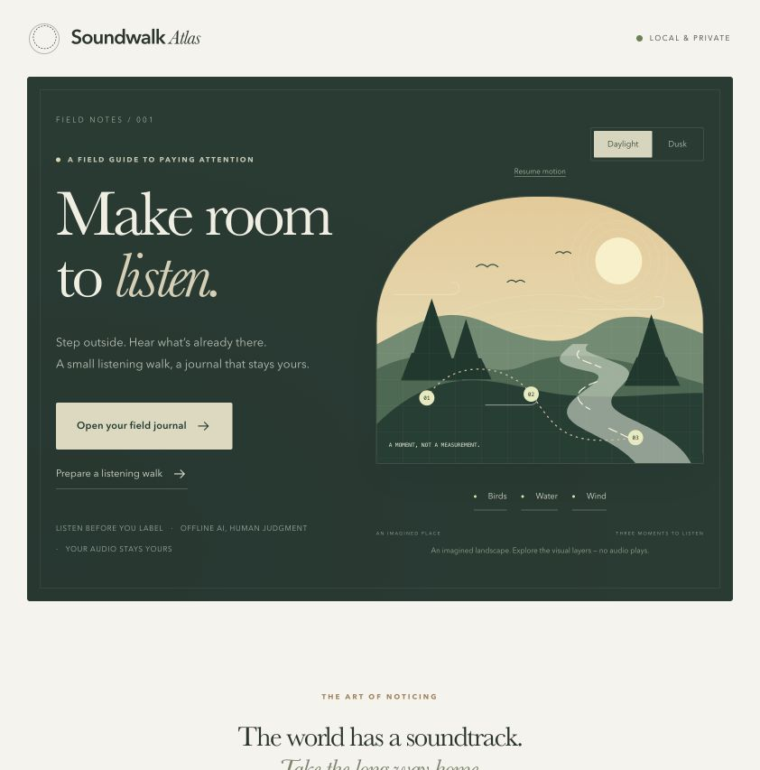

# Soundwalk Atlas

A short listening walk. A private local audio model. A second visit that helps you notice what changed in your recordings.



Built October 2026 with Codex and research/build subagents. This is an original Hacktoberfest Week 1 project, separate from upstream contribution PRs. No real outdoor trial or contest entry is claimed.

## The experience

1. Name a familiar route and its stops. Print the listening card.
2. Listen first, write your own observation, optionally record a short clip with your phone's recorder.
3. Back at your Mac, create a visit and import clips. Original notes are recorded before model suggestions.
4. Choose a ten-second interval, analyse locally, listen, and confirm your own labels, reject mismatched suggestions or record uncertainty.
5. Repeat the route and compare the two visits. Missing recordings remain missing.

Model similarity is not confidence, species identification, decibel measurement or environmental quality. Short recordings do not establish a trend. The person remains authoritative.

## Run locally

Requirements: Python 3.12, Node 20.19+ or 22.12+, npm, and enough free memory/disk for the pinned CLAP checkpoint. The verified machine and measurements are recorded in `docs/STAGE-REVIEWS.md` after validation. No paid API is needed.

```sh
uv venv --python 3.12 .venv
uv pip install --python .venv/bin/python -r requirements-backend.txt -r requirements-model.txt
cd frontend
npm ci
npm run build
cd ..
.venv/bin/python scripts/prepare_model.py
.venv/bin/python scripts/run.py
```

After installation, run `.venv/bin/python scripts/check_setup.py` for a read-only readiness check. On macOS, `scripts/start.command` launches the prepared installation without downloads.

Open **http://127.0.0.1:8765**. The model preparation step downloads the exact pinned model once; analysis then uses local files only. Without model assets, the app supports preparation/review of existing data and reports that analysis needs setup; it never invents predictions. If `uv` is unavailable, create a Python 3.12 virtualenv and install the same requirement files with pip.

Model location defaults to `~/.cache/soundwalk-atlas/<revision>`. Set `SOUNDWALK_MODEL_DIR` to an explicitly prepared local folder if needed. Application records/audio default to `~/.local/share/soundwalk-atlas`; set `SOUNDWALK_DATA_DIR` for an isolated demo. Neither private recordings nor model files belong in the source repository.

## Sample journey

The app offers an explicitly **synthetic example**, created from mathematically generated WAV fixtures. It is useful for demonstrating import/playback/review/comparison, and can be analysed by the actual local model. It is not a field recording, independent classification benchmark, ecological finding or invented human testimonial. The source/CC0 notice lives in `tests/fixtures/LICENSE.md`.

## Audio and privacy boundaries

- Input limits: 20 MB, at most 30 seconds; suggested capture is 10 seconds. Actual supported containers are checked by bounded decoding.
- Analysis uses a selected interval of up to ten seconds at 48 kHz mono, padding shorter clips with zeros. The first interval is the default. The actual waveform and last analysed interval are shown separately; moving the selector does not change saved predictions until you analyse again.
- Eleven candidate categories: birds, traffic, wind/leaves, water, machinery, people/voices, animals, footsteps, paper rustling, rain and insects. Similarity matching always proposes candidates for non-silent audio; it cannot reliably detect unsupported sounds. Digital silence abstains, quiet/clipping warnings concern recording amplitude only. Human labels, multiple sounds, uncertainty and “none fits” remain separate judgments.
- Bind only to loopback. Do not expose the service to a public interface or LAN to access it from a phone.
- Phone-to-Mac recorder-file transfer is the supported outdoor path. This release does not promise on-phone inference, background browser recording or a fully offline phone PWA.
- No cloud inference, third-party analytics or precise location is necessary. Avoid capturing bystander conversations. Local processing cannot retroactively provide recording consent.
- Exported copies/backups remain outside the app's control when deleting app-owned data. JSON export omits audio.

## Checks

```sh
PYTHONPATH=backend .venv/bin/python -m pytest tests backend/tests
cd frontend
npm run typecheck
npm test
npm run build
cd ..
.venv/bin/python scripts/benchmark_model.py
```

API tests isolate inference with a clearly named test double so failures/queue behavior can be tested quickly; the benchmark exercises the actual downloaded model. Those are separate evidence categories. See `docs/STAGE-REVIEWS.md` for performed checks and unresolved limitations, and `docs/` for the benchmark output.

## Licensing and attribution

Application code: MIT, copyright Yash Anand. The pinned `laion/clap-htsat-unfused` checkpoint identifies Apache-2.0; keep model and dependency terms separate from our application license. Model revision: `8fa0f1c6d0433df6e97c127f64b2a1d6c0dcda8a`. Source: https://huggingface.co/laion/clap-htsat-unfused. Generated fixture audio: CC0 with explicit provenance. The installed imageio-ffmpeg wrapper is BSD; its bundled Mac FFmpeg binary reports GPL-2.0-or-later. The source archive excludes that binary, all installed dependencies and model weights. Do not assume external audio datasets can be redistributed without their own rights checks.

CLAP research: Wu et al., *Large-scale Contrastive Language-Audio Pretraining with Feature Fusion and Keyword-to-Caption Augmentation*, https://arxiv.org/abs/2211.06687.

## Submission status

The official challenge permits a working synthetic demo with truthful limitations. Genuine outdoor use strengthens the Touch Grass story; our recommended two-visit trial is not a formal entry prerequisite. An independent evaluation is necessary before making accuracy claims, which this entry does not make. The user must review the final contest entry and applicable obligations before publishing. No DEV post or contest entry has been published. Publishing this repository does not submit an entry.

## Field and submission guides

Use [the field-trial guide](docs/FIELD-TRIAL.md) for two genuine outdoor visits and [the submission checklist](docs/SUBMISSION-CHECKLIST.md) for the final article. Review evidence lives in [stage reviews](docs/STAGE-REVIEWS.md).

## Interactive interface

The redesigned field-instrument interface includes an original day/dusk landscape with selectable visual layers and pausable motion, a one-minute listening timer, real journal totals and keyboard-accessible station navigation. See [UI review evidence](docs/UI-REDESIGN-REVIEW.md). Illustrations are clearly imagined; they never claim to represent live audio or a measured environment.

## Integrated journal upgrades

Written observations work without recordings and retain context/time. Review labels are never automatically copied from model suggestions. Per-recording analysis can be cancelled; late results cannot overwrite cancelled work. Focus mode, next-action guidance, actual waveforms and responsive comparisons share the same journal interface. Decorative motion can be paused and follows reduced-motion preferences.

A private ZIP backup includes original audio, notes, reviews and model provenance. Restore validates checksums, bounded audio, references and metadata, then adds new record IDs atomically; it never overwrites existing visits. Re-importing the same archive is rejected. Limits are 200 MB and 500 records/files as enforced by the archive validator. JSON export is records-only and is not a restore format. Private backups may contain conversations or sensitive notes: do not publish them. Unsaved browser drafts are not included in backups.

Draft text survives internal navigation/reload in this browser's local storage; a pending selected file survives internal navigation but must be reselected after browser reload. Clearing browser data clears unsaved drafts. Saving is still necessary for portable records.

See [upgrade review](docs/UPGRADE-REVIEW.md) and [evaluation protocol](docs/evaluation/README.md). Expanded prompts are a development improvement, not proof of independent field accuracy.

## Submission package and public demo

[Watch the public captioned walkthrough](https://yashanand69.github.io/soundwalk-atlas/#demo). The static demo page shows an edited 72-second sequence of actual application screens with synthetic data; it does not host the journal service or expose private recordings. [DEV draft](docs/DEV-SUBMISSION.md), [demo transcript](docs/demo/TRANSCRIPT.md) and [final checklist](docs/SUBMISSION-CHECKLIST.md) are provided. The article is prepared but not published.

The new scroll-led trail draws an imagined path and moves a marker as the narrative scrolls, with slight depth movement in the landscape. It is not a real route tracker. Reveal motion is progressive enhancement, respects keyboard focus and reduced-motion preferences, and can be paused.
